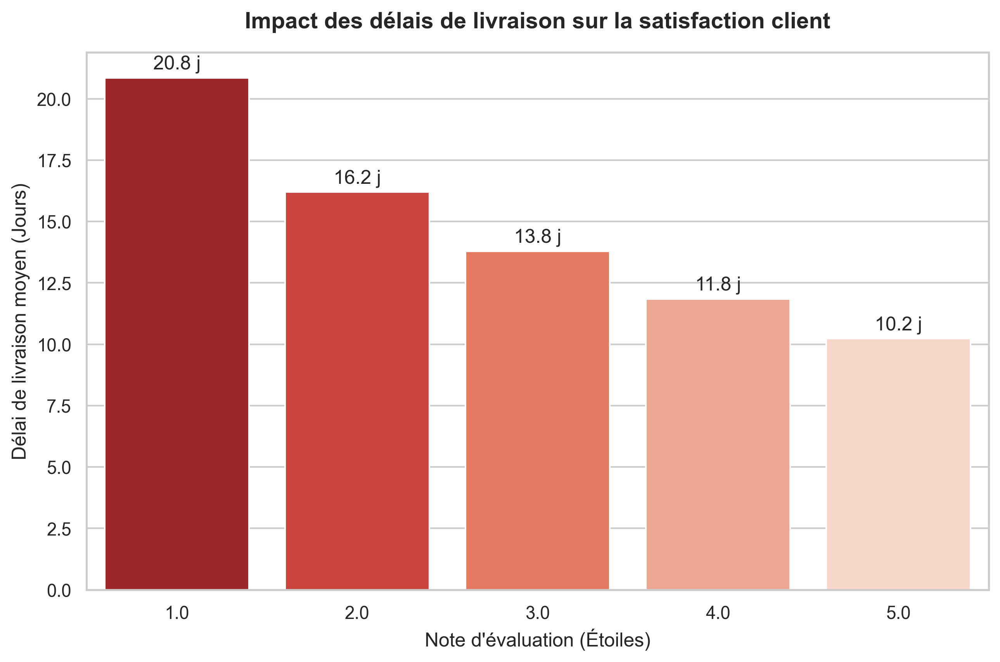
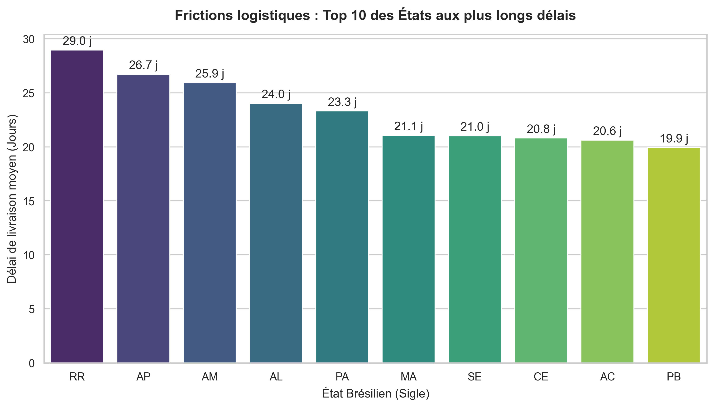

# 📦 olist-logistics-analytics


Ce projet analyse les performances logistiques et l'impact des délais de livraison sur la satisfaction client, à partir du jeu de données public du e-commerçant brésilien Olist. Le processus complet, de l'extraction des données à la visualisation, est réalisé 100% en Python.

## 🎯 Méthodologie STAR

### 📍 Situation

Dans le secteur du e-commerce, la chaîne d'approvisionnement est un facteur critique de succès. Olist, une plateforme brésilienne, dispose de milliers de transactions réparties dans plusieurs bases de données relationnelles. Le défi métier est d'identifier comment les délais d'acheminement impactent directement les notes laissées par les clients, afin de formuler des recommandations d'optimisation claires pour les décideurs.

### 📋 Tâche (Task)

Ce projet de bout en bout visait deux objectifs majeurs :

1. Construire un pipeline de préparation de données (ETL) pour modéliser une vue unifiée à 360° ("Gold Table") à partir de données brutes.
2. Analyser visuellement cette donnée structurée pour extraire des _Business Insights_ tangibles prouvant la corrélation entre logistique et satisfaction.

### 🛠️ Action

Le développement a été scindé en deux scripts Python :

**1. Data Engineering & ETL (`1_exploration.ipynb`) :**

- **Ingestion :** Extraction des 3 tables majeures (Commandes, Clients, Avis) totalisant près de 100 000 lignes.
- **Data Cleaning & Typage :** Conversion des jalons logistiques du format texte brut vers des formats temporels calculables (`datetime`).
- **Feature Engineering :** Création du KPI `delivery_time_days` (delta entre achat et livraison réelle).
- **Modélisation Relationnelle :** Consolidation via des jointures (Inner et Left Joins) pour lier le client, la commande et le score final.

**2. Data Visualisation (`2_visualisation.ipynb`) :**

- Génération de graphiques analytiques professionnels avec `matplotlib` et `seaborn`.
- Analyse par segments (score d'évaluation) et par géographie (États brésiliens).

### 📈 Résultat (Result)

Création d'un jeu de données analytique propre (`data/olist_master_dataset.csv`) et mise en évidence de recommandations stratégiques grâce au Data Storytelling.

---

## 📊 Visualisations et Insights Métier

**1. La rapidité est la clé de la rétention**
L'analyse démontre une corrélation directe : les clients insatisfaits (1 étoile) subissent des délais dépassant 20 jours en moyenne. À l'inverse, l'excellence logistique (délais inférieurs à 11 jours) est le prérequis pour obtenir la note maximale.


**2. Disparités régionales critiques**
L'analyse géographique révèle de fortes frictions dans des États comme Roraima (RR) ou Amapá (AP), avec des délais moyens dépassant les 25 jours. Ces zones justifient prioritairement l'ouverture de centres de distribution relais.


---

## 💻 Comment reproduire ce projet en local

Ce projet respecte les bonnes pratiques de développement en utilisant un environnement virtuel isolé.

1. **Cloner le dépôt :**
   ```bash
   git clone https://github.com/AdamaSANE/olist-logistics-analytics.git
   cd olist-logistics-analytics
   ```
